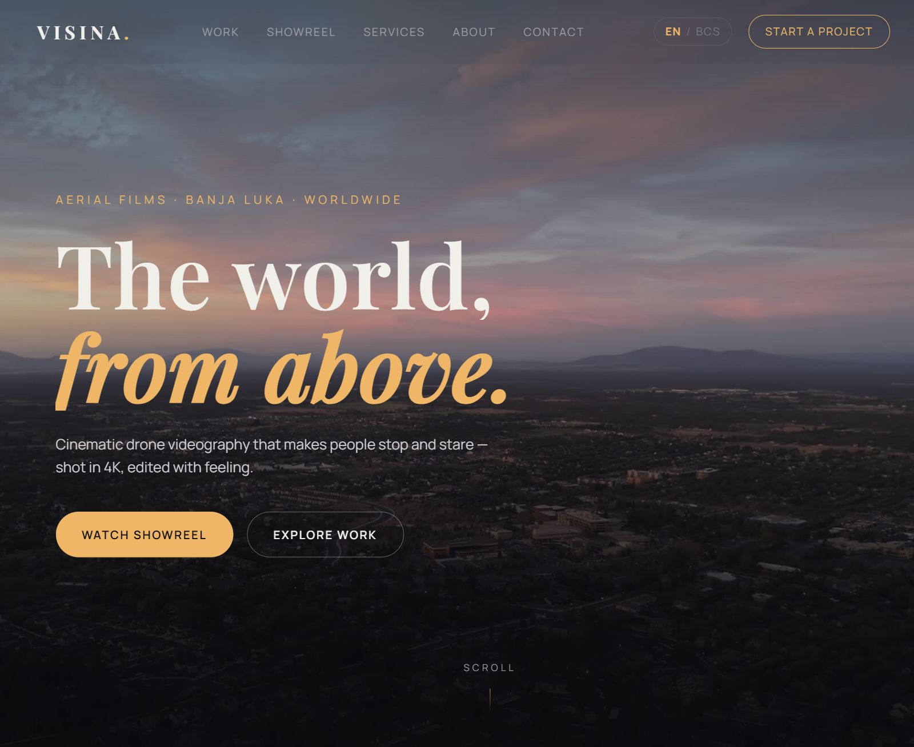
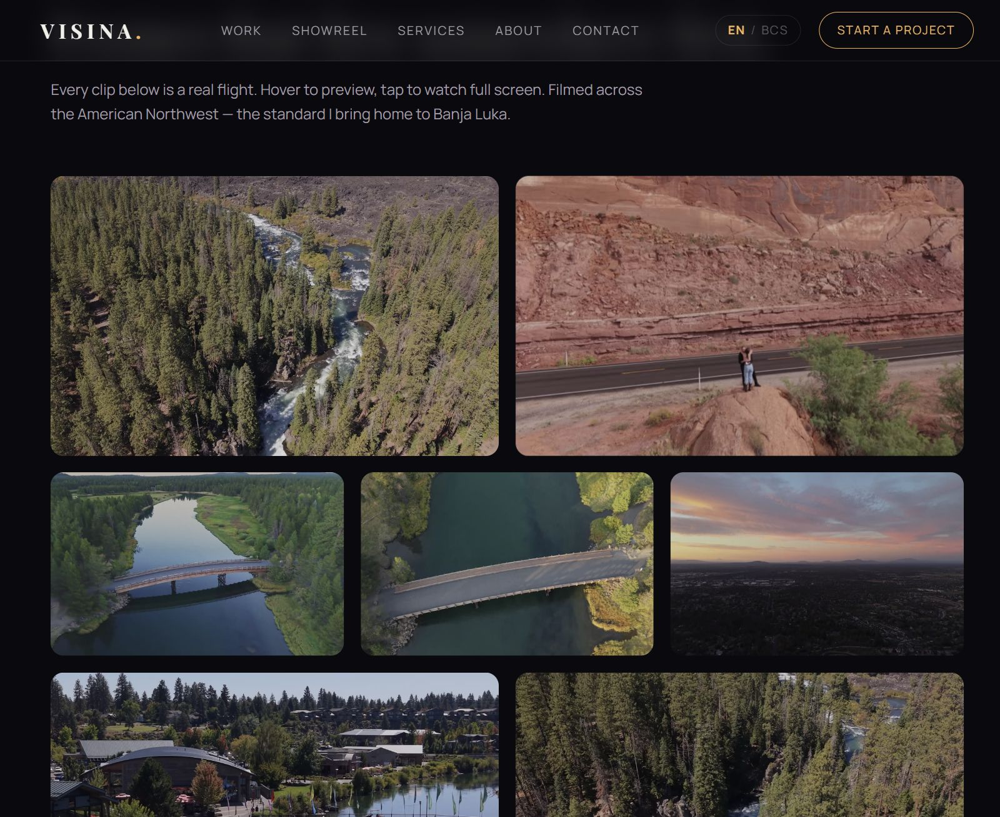

# VISINA — Aerial Films

> **The world, from above.** · *Svet, odozgo.*

Cinematic drone videography by **Đorđe Mirković** — based in **Banja Luka, Bosnia & Herzegovina**, available across the region and beyond.

<p align="center">
  
</p>

---

## About the site

A single-page, cinematic portfolio built to do one thing: make people stop and stare. Every clip on the page is a real flight — 4K/60 drone footage cut into fast-loading web snippets, wrapped in a dark studio-grade design with sunset-amber and river-teal accents pulled straight from the footage itself.

<p align="center">
  
</p>

**Highlights**

- 🎬 **13 web-optimized video snippets** — cut from 4K DJI masters, H.264, ~52 MB total
- 🖱️ **Hover-to-preview gallery** with a full-screen lightbox player (keyboard navigation included)
- 📽️ **Showreel section** — a 36-second cut from the first full edit, with sound
- 🌐 **Bilingual EN / BCS** — full translation with a persistent toggle and automatic language detection
- 📬 **Contact without a backend** — the form composes an email on the visitor's device; direct email, phone/WhatsApp and Instagram links alongside
- ⚡ **Zero dependencies, zero build step** — plain HTML/CSS/JS, deploys anywhere static files are served

## What's filmed

Portfolio footage was shot across the **American Northwest (Oregon, USA)** — Benham Falls, Pilot Butte, Sunriver, the Old Mill District and the red-rock canyons in between. The standard it represents is what VISINA brings to projects in **Banja Luka, BiH and the region**: real estate, weddings & events, tourism & hospitality, and custom aerial work.

## Project structure

```
visina-site/
├── index.html          # the whole site — one page, all sections
├── css/style.css       # theme, layout, animations, responsive rules
├── js/main.js          # i18n (EN/BCS), gallery, lightbox, form, reveals
├── assets/
│   ├── videos/         # web-optimized MP4 snippets (committed on purpose)
│   └── img/            # poster frames + og:image
├── docs/               # README preview screenshots
├── AGENTS.md           # conventions for AI agents working in this repo
└── favicon.svg
```

## Running locally

No build, no install — it's static:

```bash
# any static server works, e.g.
uv run python -m http.server 8000
# → http://localhost:8000
```

## Deploying

**Live: <https://mirkoviccdjordje-code.github.io/visina-site/>** — GitHub Pages, serving `main` automatically on every push.

## Contact

- **Email:** [mirkoviccdjordje@gmail.com](mailto:mirkoviccdjordje@gmail.com)
- **Phone / WhatsApp:** [+387 66 990 485](tel:+38766990485)
- **Instagram:** [@mirkovicc.d_](https://instagram.com/mirkovicc.d_)
- **Base:** Banja Luka, Bosnia & Herzegovina — working region-wide

---

© 2026 VISINA — Aerial Films · Đorđe Mirković. All footage © respective shoot dates.
